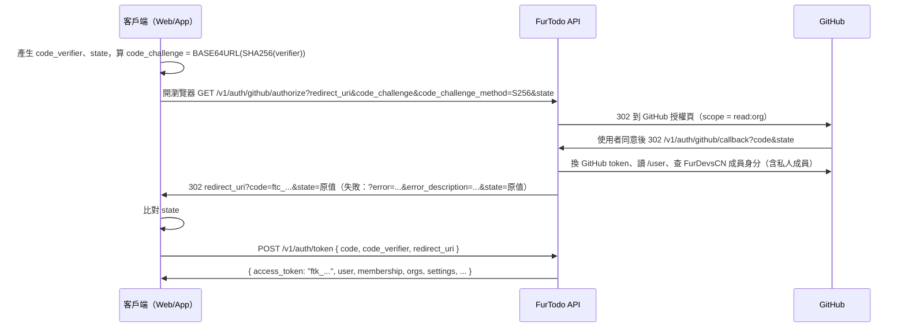

# FurTodo API 對接指南

> 給要做 **Web（CSR，不要 SSR）** 與 **App** 的工程師／AI agent。照這份文件就能做出完整、可離線使用的待辦 App。
> 機器可讀規格：`/openapi.json`（OpenAPI 3.1）。互動文件：`/docs`。本文件線上版：`/integration.md`。

## 0. 速查

| 項目 | 值 |
|---|---|
| Base URL（測試後端） | `https://todo.example.com` |
| OpenAPI | `https://todo.example.com/openapi.json` |
| 互動文件（可直接試打 API） | `https://todo.example.com/docs` |
| 開發者登入／取得 token | `https://todo.example.com/dev/login` |
| 登入方式 | GitHub OAuth（只限 GitHub 組織 **FurDevsCN** 成員，私人成員身分也可以） |
| 認證 | `Authorization: Bearer ftk_...`（不使用 cookie） |
| CORS | 任何 origin；允許 `Authorization`、`Content-Type` header |
| 日期 | `YYYY-MM-DD`（日曆日，不含時區） |
| 時間 | `HH:mm`（24 小時制，依使用者設定的時區解讀） |
| 時刻 | ISO 8601；伺服器回應一律是 UTC，例如 `2026-11-20T07:00:00.000Z` |
| ID | 客戶端產生，建議 **UUIDv7**；只允許 `A-Z a-z 0-9 _ -`，長度 1–64 |
| 錯誤格式 | `{ "error": { "code": "...", "message": "...", "details": { ... } } }` |
| 除錯 | 每個回應都有 `X-Request-Id`，回報問題時附上 |

**一句話架構**：每個實體（任務、清單…）是一筆 KV 資料；每位使用者有一個 Durable Object 負責 session、每日配額、寫入序列化、提醒鬧鐘與推播。客戶端應該做成 **離線優先（offline-first）**：本地資料庫是 UI 的真實來源，背景用 `/v1/sync/push` 與 `/v1/sync/pull` 同步。

---

## 1. 功能對照表（做 App 時的驗收清單）

| 需求 | 對應欄位／API | UI 必須做到 |
|---|---|---|
| 明確的行動動詞 | `task.title` | 輸入框 placeholder 提示「用動詞開頭，例如：打電話給王先生確認報價」 |
| 截止日期 | `dueDate`、`dueTime`（`dueAt` 唯讀） | 日期＋選填時間；逾期紅字 |
| 提醒 | `reminders[].at` | 可加多個提醒；Web 用 Web Push、App 用本地通知（§8） |
| 預估時間／精力 | `estimateMinutes`、`energy` | 15m/30m/1h 快捷；低/中/高精力；「零碎時間」篩選（`maxEstimate`） |
| 優先順序 | `priority`（0–3） | 星號或顏色 |
| 四象限 | `quadrant`（1–4，null 未分類） | 四象限視圖 `/v1/views/matrix` |
| 清單／資料夾 | `list`、`folder`、`task.listId` | 側欄：資料夾 → 清單；沒有清單 = 收件匣 |
| 情境標籤 | `tag`、`task.tagIds` | `#外出辦事`、`#電腦前`、`#低耗腦力`；依標籤篩選 |
| 子任務 | `subtasks[]` | 勾選清單、拖曳排序、進度（3/5） |
| 備註與附件 | `notes`（Markdown）、`links[]`、`attachments[]` | 備註編輯器、連結（網址/mailto/tel）、檔案上傳 |
| 週期性重複 | `recurrence` | 每天/每週幾/每月幾號/每年/完成後 N 天；完成時伺服器自動產生下一期 |
| 快速收集 | `POST /v1/capture` | 全域快捷鍵／浮動按鈕，一行文字 1–2 秒內存好（§7） |
| 今日視圖 | `myDay`、`/v1/views/today` | 「我的一天」：挑今天要做的事；顯示最關鍵 1–3 件（focus） |
| 多平台同步＋離線 | `/v1/sync/*` | 無網路可新增/編輯/完成；恢復連線自動同步（§5） |

---

## 2. 登入：GitHub OAuth + PKCE

### 2.1 流程



- 組織成員身分用使用者自己的 token 查 `GET /user/memberships/orgs/FurDevsCN`，**不需要**把成員身分設為公開。
- 登入後伺服器每 6 小時重新向 GitHub 確認一次；不再是成員就撤銷所有 session（API 回 `403 not_org_member`）。
- 授權頁若看到 FurDevsCN 旁有 **Request／Grant** 按鈕：代表組織啟用了「OAuth App 存取限制」。成員按 Request，owner 按 Grant（或到 `https://github.com/organizations/FurDevsCN/settings/oauth_application_policy` 核准），否則會得到 `org_access_restricted` 或 `not_org_member`。

### 2.2 redirect_uri 白名單

| 樣式 | 用途 |
|---|---|
| `http://localhost:*/*`、`http://127.0.0.1:*/*` | 本機開發（任何 port、任何 path） |
| `https://*.example.com/*` | 正式部署的 Web |
| `furtodo://*` | App（custom URL scheme，建議 `furtodo://auth/callback`） |
| `https://todo.example.com/dev/login` | 內建開發者登入頁 |

要加新網域請改後端的 `ALLOWED_REDIRECT_URIS`。不在白名單 → `400 bad_request`（不會導向）。

### 2.3 Web（CSR）範例

```ts
const API = "https://todo.example.com";
const REDIRECT_URI = `${location.origin}/auth/callback`;

const b64url = (buf: ArrayBuffer | Uint8Array) =>
  btoa(String.fromCharCode(...new Uint8Array(buf))).replace(/\+/g, "-").replace(/\//g, "_").replace(/=+$/, "");

export async function startLogin() {
  const verifier = b64url(crypto.getRandomValues(new Uint8Array(32)));
  const state = b64url(crypto.getRandomValues(new Uint8Array(16)));
  sessionStorage.setItem("pkce", JSON.stringify({ verifier, state }));
  const challenge = b64url(await crypto.subtle.digest("SHA-256", new TextEncoder().encode(verifier)));
  const q = new URLSearchParams({ redirect_uri: REDIRECT_URI, code_challenge: challenge, code_challenge_method: "S256", state });
  location.assign(`${API}/v1/auth/github/authorize?${q}`);
}

// 在 /auth/callback 路由執行
export async function finishLogin(): Promise<string> {
  const q = new URLSearchParams(location.search);
  const saved = JSON.parse(sessionStorage.getItem("pkce") ?? "null");
  sessionStorage.removeItem("pkce");
  if (q.get("error")) throw new Error(`${q.get("error")}: ${q.get("error_description")}`);
  if (!saved || saved.state !== q.get("state")) throw new Error("state mismatch");
  const res = await fetch(`${API}/v1/auth/token`, {
    method: "POST",
    headers: { "Content-Type": "application/json" },
    body: JSON.stringify({ grant_type: "authorization_code", code: q.get("code"), code_verifier: saved.verifier, redirect_uri: REDIRECT_URI }),
  });
  const body = await res.json();
  if (!res.ok) throw new Error(body.error.message);
  localStorage.setItem("token", body.access_token); // 或存 IndexedDB
  history.replaceState(null, "", "/");
  return body.access_token;
}
```

`/dev/login` 頁面的原始碼就是完整的參考實作（瀏覽器「檢視原始碼」）。

### 2.4 App 範例要點

1. `redirect_uri = furtodo://auth/callback`，在 App 註冊 custom URL scheme `furtodo`。
2. 用 **系統瀏覽器元件** 開 authorize 網址：iOS `ASWebAuthenticationSession`、Android Custom Tabs。
   Flutter：`flutter_web_auth_2`（callbackUrlScheme: `furtodo`）；Expo：`expo-web-browser` 的 `openAuthSessionAsync`。
3. 收到 `furtodo://auth/callback?code=...&state=...` 後，同 Web 呼叫 `POST /v1/auth/token`。
4. token 存在安全儲存（Keychain / Keystore；Flutter `flutter_secure_storage`、Expo `expo-secure-store`）。

### 2.5 登入失敗的 `error` 值（回到 redirect_uri 的 query）

| error | 意義／處理 |
|---|---|
| `access_denied` | 使用者在 GitHub 取消 |
| `not_org_member` | 不是 FurDevsCN 成員（或組織擋住 OAuth App，見 2.1） |
| `org_membership_pending` | 有邀請但還沒接受：請到 GitHub 接受組織邀請 |
| `org_access_restricted` | 組織啟用 OAuth App 存取限制，需 owner 核准 |
| `insufficient_scope` | 沒拿到 `read:org` |
| `github_error` / `invalid_request` | GitHub 暫時有問題，重試 |
| `quota_exceeded` | 今日登入次數超過上限 |

`POST /v1/auth/token` 失敗回 `400`，`details.oauthError = "invalid_grant"`（登入碼過期 5 分鐘／已用過／verifier 或 redirect_uri 不符）→ 重新登入。

### 2.6 Token 與 session

- access token 有效 30 天，**有使用就自動延長**（滑動到期）。沒有 refresh token。
- 任何 API 回 `401`（`invalid_token`、`session_expired`）→ 清掉 token、導到登入。
- `GET /v1/me`：使用者、組織角色、**使用者所屬的 GitHub 組織清單**、設定。
- `GET /v1/auth/sessions`：所有登入中的裝置；`DELETE /v1/auth/sessions/{id}`：登出某裝置；`POST /v1/auth/logout`：登出目前裝置。
- `POST /v1/auth/tokens` `{ "name": "...", "expiresInDays": 90 }`：建立**個人 token**（給 CLI／腳本／AI agent 測 API；只回傳一次）。也可以在 `/dev/login` 點按鈕建立。

---

## 3. 資料模型

### 3.1 所有實體共通欄位（唯讀）

| 欄位 | 型別 | 說明 |
|---|---|---|
| `id` | string | 客戶端產生（建議 UUIDv7） |
| `rev` | int | 每次變更 +1 |
| `createdAt` | ISO | |
| `updatedAt` | ISO | 伺服器時間，同一使用者內嚴格遞增 |
| `deletedAt` | ISO \| null | 非 null = 在垃圾桶（30 天後永久刪除） |

### 3.2 Task

| 欄位 | 型別 | 預設 | 說明 |
|---|---|---|---|
| `title` | string 1–500 | 必填 | 具體可執行的動作 |
| `notes` | string ≤ 20000 | `""` | Markdown，可放聯絡方式、參考資料 |
| `listId` | id \| null | null | null = 收件匣 |
| `tagIds` | id[] ≤ 20 | `[]` | 情境標籤 |
| `priority` | 0–3 | 0 | 0 無、1 低、2 中、3 高 |
| `quadrant` | 1–4 \| null | null | 1 重要且緊急、2 重要不緊急、3 緊急不重要、4 都不 |
| `dueDate` | date \| null | null | |
| `dueTime` | time \| null | null | 需要 dueDate；沒有 dueDate 時伺服器會清成 null |
| `dueAt` | ISO \| null | 唯讀 | dueDate+dueTime 依使用者時區換算；全天任務為 null |
| `reminders` | `{id, at}[]` ≤ 10 | `[]` | `at` 絕對時刻；id 省略時伺服器補 |
| `estimateMinutes` | 1–1440 \| null | null | |
| `energy` | `low`\|`medium`\|`high`\|null | null | |
| `subtasks` | `{id, title, completed}[]` ≤ 100 | `[]` | **整個陣列一起覆寫**；陣列順序即顯示順序 |
| `links` | `{id, url, title}[]` ≤ 50 | `[]` | url 限 `http(s)://`、`mailto:`、`tel:` |
| `attachments` | `{id, name, size, contentType, createdAt}[]` | 唯讀 | 用 §9 的 API 管理 |
| `recurrence` | Recurrence \| null | null | §3.5 |
| `seriesId` | id \| null | 唯讀 | 重複系列共用 |
| `myDay` | date \| null | null | 加入「我的一天」的日期 |
| `myDayOrder` | number \| null | null | My Day 內排序 |
| `sortOrder` | number | 建立時間 ms | 清單內排序 |
| `completedAt` | ISO \| null | null | null = 未完成 |

### 3.3 List / Folder / Tag / Settings

| 實體 | 欄位 |
|---|---|
| `list` | `name`（必填 ≤100）、`color`（`#RRGGBB`\|null）、`icon`（≤32，emoji 或圖示名）、`folderId`（\|null）、`sortOrder`、`archived`（bool） |
| `folder` | `name`（必填 ≤100）、`sortOrder` |
| `tag` | `name`（必填 ≤32，不可含空白、`#`、`@`）、`color`。名稱不保證唯一 |
| `settings`（id 固定 `"main"`） | `timezone`（IANA，預設 `Asia/Taipei`）、`weekStart`（0 週日／1 週一，預設 1）、`defaultReminderTime`（預設 `09:00`）、`todayIncludesOverdue`（預設 true）、`locale`（預設 `zh-TW`） |

### 3.4 排序

`sortOrder`、`myDayOrder` 是浮點數，小的在前。插入到 A、B 之間用 `(A + B) / 2`；放最前面用 `第一個 - 1024`、最後面用 `最後一個 + 1024`。間距小於 `1e-6` 時才整批重新編號（會產生多筆寫入，盡量避免）。

### 3.5 重複任務（Recurrence）

```jsonc
{
  "freq": "weekly",          // daily | weekly | monthly | yearly
  "interval": 1,             // 每 N 個 freq（1–365）
  "byWeekday": [1, 3, 5],    // weekly：0=週日…6=週六；省略 = 到期日那天的星期
  "byMonthDay": 15,          // monthly/yearly：1–31，-1 = 月底；月份沒那天就用月底
  "byMonth": 3,              // yearly：1–12
  "until": "2027-12-31",     // 選填，含當天
  "count": 10,               // 選填，剩餘次數（含本期）
  "basis": "due"             // due：照排程；completion：完成日 + interval
}
```

- 設定 `recurrence` 時伺服器會**正規化**：把省略的 `byWeekday`／`byMonthDay`／`byMonth` 依到期日補上並存起來（避免 1/31 → 2/28 → 3/28 的漂移）。沒有 `dueDate` 時，伺服器把 `dueDate` 設成今天（含）以後第一個符合的日期。
- **完成重複任務時伺服器會產生下一期**（新任務，`seriesId` 相同），回在 `spawned`（REST `/complete` 或 sync push 結果），之後也會出現在 pull。
  - **客戶端不要自己建立下一期**。下一期的 id 由「系列＋日期」決定，多台裝置同時完成也不會重複。
  - 複製：title、notes、listId、tagIds、priority、quadrant、dueTime、estimateMinutes、energy、links、子任務（全部改回未完成）、提醒（往後平移同樣天數）。不複製：附件、myDay、completedAt。
  - `basis: "due"` 逾期才完成：下一期會追到「今天（含）以後」，不會補一堆過去的。
  - `count` 用完或超過 `until` 就不再產生。

### 3.6 刪除與垃圾桶

- 刪除＝移到垃圾桶（`deletedAt` 有值），30 天內可 `POST /v1/{tasks|lists|folders|tags}/{id}/restore` 還原。`GET /v1/trash` 列出垃圾桶。
- **刪除清單**：清單內的任務在背景一起移到垃圾桶（通常幾秒內，從 pull 收到）；還原清單會把它們一起還原。客戶端刪除清單時，本地也直接把這些任務標成刪除即可。
- **刪除標籤／資料夾**：任務的 `tagIds`、清單的 `folderId` **不會被清掉**（這樣還原時能完整恢復）。客戶端顯示時忽略指向已刪除或不存在實體的 id。
- 還原任務時，如果它的清單已刪除，會被移到收件匣。
- 已刪除的實體不能修改（`409 deleted`），要先還原。

---

## 4. API 一覽

所有 `/v1/*`（除了標註「公開」）都要 `Authorization: Bearer`。完整請求／回應 schema 看 `/openapi.json`。

| 方法 | 路徑 | 說明 |
|---|---|---|
| GET | `/v1/auth/github/authorize` | 公開。開始登入（§2） |
| POST | `/v1/auth/token` | 公開。登入碼換 token |
| POST | `/v1/auth/logout` | 登出目前 session |
| GET / DELETE | `/v1/auth/sessions`、`/v1/auth/sessions/{id}` | 裝置管理 |
| POST | `/v1/auth/tokens` | 建立個人 token |
| GET | `/v1/me` | 使用者、組織、組織清單、設定 |
| GET | `/v1/usage` | 今日配額用量與上限 |
| GET / PATCH | `/v1/settings` | 設定 |
| GET | `/v1/tasks` | 查詢：`status=open\|completed\|all`、`listId`、`inbox=true`、`tagId`、`q`、`dueFrom`、`dueTo`、`priority`、`quadrant`、`energy`、`maxEstimate`、`myDay`、`includeDeleted`、`limit`（≤2000） |
| POST | `/v1/tasks` | 建立（可帶 `id`；同 id 重送是冪等的） |
| GET / PATCH / DELETE | `/v1/tasks/{id}` | 讀／部分更新／刪除 |
| POST | `/v1/tasks/{id}/complete`、`/uncomplete`、`/restore` | 完成（回 `{task, spawned}`）、取消完成、還原 |
| GET / POST | `/v1/lists`、`/v1/folders`、`/v1/tags` | 列出全部（未刪除）／建立 |
| GET / PATCH / DELETE | `/v1/{lists\|folders\|tags}/{id}` | |
| POST | `/v1/{lists\|folders\|tags}/{id}/restore` | |
| GET | `/v1/trash` | 垃圾桶 `{ items: [{ type, entity }] }` |
| GET | `/v1/views/today?date=` | 今日視圖（§6） |
| GET | `/v1/views/upcoming?from=&days=` | 即將到來，依日期分組（days ≤ 62） |
| GET | `/v1/views/matrix` | 四象限 |
| POST | `/v1/capture` | 快速收集（§7） |
| POST | `/v1/sync/push` | 批次送出變更（§5） |
| GET | `/v1/sync/pull?cursor=&limit=` | 拉增量（§5） |
| POST | `/v1/tasks/{id}/attachments` | 上傳附件（§9） |
| DELETE | `/v1/tasks/{id}/attachments/{attachmentId}` | 刪附件 |
| GET | `/v1/attachments/{attachmentId}` | 下載（Bearer） |
| GET | `/v1/attachments/{attachmentId}/url` | 1 小時有效的簽章網址 |
| GET | `/v1/files/{userId}/{attachmentId}?exp&sig` | 公開（靠簽章）。下載 |
| GET | `/v1/push/vapid-public-key` | 公開。Web Push 公鑰 |
| POST / DELETE | `/v1/push/subscriptions` | 登記／取消推播訂閱（DELETE 用 `?endpoint=`） |
| POST | `/v1/push/test` | 送測試推播 |

PATCH 只送要改的欄位；未知欄位或唯讀欄位會 `400 validation_error`。PATCH 不存在的 id → `404`（建立請用 POST）。

---

## 5. 離線同步（最重要）

### 5.1 原則

- 本地資料庫（Web：IndexedDB／Dexie；App：SQLite）存所有實體，**UI 只讀本地**。
- 使用者的每個操作：立刻改本地 → 加一筆 mutation 到 **outbox**（本地佇列）→ 排程同步。
- 同步 = 先 `push` outbox，再 `pull` 到沒有更多為止。
- 觸發時機：App 啟動、回到前景、網路恢復、本地編輯後（debounce 1–2 秒）、前景時每 30–60 秒輪詢。
- **沒有變更時 pull 幾乎不耗配額**，放心輪詢；但不要比每 15 秒更頻繁。

### 5.2 Push

```http
POST /v1/sync/push
{
  "mutations": [
    { "op": "upsert", "type": "task", "id": "019a…", "data": { "title": "買牛奶", "listId": null }, "at": 1763539200000 },
    { "op": "upsert", "type": "task", "id": "019b…", "data": { "completedAt": "2026-11-19T02:00:00.000Z" }, "at": 1763539300000 },
    { "op": "delete", "type": "tag",  "id": "019c…", "at": 1763539400000 },
    { "op": "restore", "type": "task", "id": "019d…" }
  ]
}
```

- `op`：`upsert`（不存在就建立、存在就部分更新）、`delete`、`restore`。
- `type`：`task`、`list`、`folder`、`tag`、`settings`（settings 的 id 固定 `"main"`）。
- `data`：該型別的 Patch（同 REST PATCH）。**只放有改的欄位**。建立時要有必填欄位（task.title、list/folder/tag.name），否則 `rejected not_found`。
- `at`：使用者**實際編輯的時間**（epoch ms）。伺服器做 **逐欄位 Last-Writer-Wins**：某欄位只有在 `at` ≥ 伺服器上該欄位最後被寫入的 `at` 時才會被覆蓋，所以離線很久的裝置不會蓋掉別台裝置較新的修改。`at` 比伺服器時間晚會被當成伺服器現在。
- 一次最多 200 筆；每筆獨立處理，回應順序與請求相同：

```jsonc
{ "results": [
  { "index": 0, "type": "task", "id": "019a…", "op": "upsert", "status": "applied", "entity": { /* 伺服器最新狀態 */ }, "spawned": [], "error": null },
  { "index": 1, "status": "applied", "entity": { … }, "spawned": [ { /* 重複任務的下一期 */ } ], … },
  { "index": 2, "status": "noop", … },
  { "index": 3, "status": "rejected", "entity": null, "error": { "code": "not_found", "message": "…", "status": 404 } }
] }
```

| status／error.code | 客戶端處理 |
|---|---|
| `applied`、`noop` | 用 `entity` 覆蓋本地（除非本地還有更新的未送出變更，見 5.4）；`spawned` 寫入本地 |
| `rejected` + `validation_error` | 丟掉這筆 mutation（程式錯誤，記 log） |
| `rejected` + `deleted` | 實體已在垃圾桶：丟掉這筆，本地用 `entity` 覆蓋（會顯示為已刪除） |
| `rejected` + `not_found` | 丟掉（例如對不存在的實體做 restore／缺必填欄位） |
| `rejected` + `quota_exceeded` | **保留** outbox，`error.retryAfter` 秒後再送 |
| `rejected` + `storage_busy` | 保留，幾秒後重送（同一筆資料 1 秒內被寫太多次） |
| `rejected` + `limit_exceeded` | 丟掉並提示使用者（資料筆數上限） |

所有 mutation 都是**冪等**的：網路中斷不知道有沒有成功時，整批重送即可。

### 5.3 Pull

```http
GET /v1/sync/pull                 # 第一次：全量快照（不含垃圾桶）
GET /v1/sync/pull?cursor=eyJ2Ijox…   # 之後：增量（含刪除）
```

```jsonc
{
  "changes": [ { "type": "task", "entity": { … } }, { "type": "settings", "entity": { … } } ],
  "cursor": "eyJ2IjoxLCJzIjoxNzYzNTM5…",   // 存起來下次帶回（不透明字串）
  "hasMore": false,                         // true → 立刻用新 cursor 再拉
  "reset": false,                           // true → cursor 太舊（> 30 天），清掉本地資料（保留 outbox），不帶 cursor 重拉
  "serverTime": "2026-11-19T10:00:00.000Z"
}
```

- `changes` 依伺服器 `updatedAt` 由舊到新，每個實體只會出現最新版本。
- `entity.deletedAt` 非 null → 本地標記刪除（或移到垃圾桶畫面）。
- `limit` 預設 500，最大 1000。
- 套用規則：只有在 `entity.rev` ≥ 本地 rev 時才覆蓋（避免倒退），且不要覆蓋本地還在 outbox 裡沒送出的欄位（見 5.4）。

### 5.4 建議的客戶端演算法

```ts
// 本地表：entities(type, id, json, rev)、outbox(seq, mutation)、meta(cursor)
async function sync() {
  // 1) push
  while (true) {
    const batch = await outbox.peek(200);
    if (batch.length === 0) break;
    const res = await api.post("/v1/sync/push", { mutations: batch.map((b) => b.mutation) });
    if (res.status === 401) return logout();
    if (!res.ok) throw new RetryLater(res); // 網路/5xx：保留 outbox，指數退避
    for (const r of res.body.results) {
      const item = batch[r.index];
      if (r.status === "rejected" && ["quota_exceeded", "storage_busy"].includes(r.error.code)) {
        return scheduleRetry(r.error.retryAfter ?? 5); // 保留這筆與之後的
      }
      await outbox.remove(item.seq);
      if (r.entity) await applyServerEntity(r.type, r.entity);
      for (const s of r.spawned) await applyServerEntity("task", s);
    }
  }
  // 2) pull
  let cursor = await meta.get("cursor");
  while (true) {
    const res = await api.get("/v1/sync/pull", cursor ? { cursor } : {});
    if (res.body.reset) { await entities.clear(); cursor = null; await meta.set("cursor", null); continue; }
    for (const c of res.body.changes) await applyServerEntity(c.type, c.entity);
    cursor = res.body.cursor;
    await meta.set("cursor", cursor);
    if (!res.body.hasMore) break;
  }
}

async function applyServerEntity(type, entity) {
  const local = await entities.get(type, entity.id);
  if (local && local.rev > entity.rev) return;          // 本地已有更新的伺服器版本
  const merged = { ...entity };
  for (const m of await outbox.pendingFor(type, entity.id)) {   // 重新套上還沒送出的本地修改
    if (m.op === "upsert") Object.assign(merged, m.data);
  }
  await entities.put(type, merged);
}
```

本地編輯時：

```ts
function editTask(id: string, changes: Partial<Task>) {
  entities.patch("task", id, changes);                               // 1. 樂觀更新 UI
  outbox.add({ op: "upsert", type: "task", id, data: changes, at: Date.now() }); // 2. 記錄變更
  debounceSync(1500);                                                // 3. 稍後同步
}
```

- 新建實體：客戶端先產生 UUIDv7 當 id，再 `upsert`（含必填欄位）。
- 文字輸入不要每個字送一次：**編輯結束或停頓 1–2 秒才寫 outbox**（同一筆資料每秒最多寫一次）。
- 同一實體連續多筆未送出的 upsert 可以合併（`data` 合併、`at` 取最大值）。
- 完成重複任務：只送 `completedAt`，下一期等伺服器回傳。離線時 UI 可以先顯示「已完成」。

### 5.5 一致性說明

- 寫入在每位使用者的 Durable Object 內序列化，伺服器上不會遺失更新；跨裝置衝突以「欄位 + 編輯時間」決定。
- 同步（push 回應、pull）一定看得到自己剛寫的資料。
- `subtasks`、`links`、`reminders`、`tagIds` 是「整個陣列」一個欄位：兩台裝置同時改同一個任務的子任務，較晚編輯的整個陣列勝出。

---

## 6. 視圖

視圖 API 方便線上模式使用；離線優先的客戶端也可以用本地資料照下面規則自己算（結果一致）。日期以使用者 `settings.timezone` 的「今天」為準。

### `GET /v1/views/today?date=YYYY-MM-DD`

| 區塊 | 規則 |
|---|---|
| `myDay` | 未完成且 `myDay == date`，依 `myDayOrder`、`sortOrder` |
| `overdue` | 未完成、`dueDate < date`、不在 My Day（`todayIncludesOverdue=false` 時為空） |
| `dueToday` | 未完成、`dueDate == date`、不在 My Day |
| `suggestions` | 不在上面三區的未完成任務中：昨天以前 My Day 沒做完的、3 天內到期、`priority=3`、`quadrant` 1 或 2；依分數排序，最多 20 筆 |
| `completed` | `completedAt` 落在當天（使用者時區） |
| `focus` | `myDay ∪ overdue ∪ dueToday` 依分數取前 3：今天最關鍵的事 |
| `stats` | `open`（三區總數）、`completed`、`plannedMinutes`（三區 estimateMinutes 總和） |

分數 = 四象限（Q1 400、Q2 200、Q3 100）＋ `priority × 50` ＋ 到期加分（逾期：60 ＋ 逾期天數 × 10，後者最多 100；今天到期 60；明天 20；後天 10）＋ 已在今天 My Day 40 ＋ 預估 ≤ 15 分鐘 5。同分依 `dueTime`、`sortOrder`。

「加入我的一天」= PATCH `myDay` 為今天；「移出」= `myDay: null`。My Day 每天自動清空（因為只認 `myDay == 今天`），昨天沒做完的會出現在 `suggestions`。

### `GET /v1/views/upcoming?from=&days=7`

`dates: [{ date, tasks }]` 從 `from`（預設今天）連續 `days` 天（含空的日子），任務依 `dueDate`、`dueTime`；`overdue` 為今天以前到期未完成（`from` 在今天以後時為空）。

### `GET /v1/views/matrix`

`q1`–`q4` 為各象限未完成任務（依分數），`unclassified` 為 `quadrant=null` 的未完成任務（最多 100）。

---

## 7. 快速收集 `POST /v1/capture`

```jsonc
// 請求
{ "text": "明天下午3點 打電話給王先生確認報價 #電腦前 @工作 !高 ~15m", "myDay": false, "dryRun": false }
// 回應 201（dryRun=true 時 200 且 task=null）
{
  "task": { … },
  "createdTags": [ { "id": "…", "name": "電腦前" } ],
  "parsed": { "title": "打電話給王先生確認報價", "dueDate": "2026-11-20", "dueTime": "15:00", "priority": 3, "estimateMinutes": 15,
              "tags": ["電腦前"], "list": "工作", "tokens": [ { "kind": "date", "text": "明天", "start": 0, "end": 2 }, … ], "warnings": [] },
  "resolved": { "listId": "…", "tagIds": ["…"], "newTags": [] },
  "warnings": []
}
```

- 輸入時用 `dryRun: true`（debounce 300ms）即時預覽，`tokens` 的位移可以拿來在輸入框標色。
- `listId` 指定清單（優先於 `@清單`）；`myDay: true` 同時加入今天的 My Day；`parse: false` 整段當標題。
- **離線時**：直接在本地建立 `title = 原文` 的任務放 outbox，不要卡住使用者。

| 語法 | 範例 | 結果 |
|---|---|---|
| `#標籤` | `#外出辦事` | 標籤（不存在自動建立；前面要有空白或在開頭） |
| `@清單` | `@工作` | 比對清單名稱（完全相同優先，再來前綴）；找不到 → warning，放收件匣 |
| `!1` `!2` `!3`／`!低` `!中` `!高`／`!low` `!med` `!high`／`!!` `!!!` | `!高` | priority |
| `!q1`–`!q4` | `!q2` | quadrant |
| `~` 時長 | `~15m` `~1h` `~1.5h` `~1h30m` `~半小時` `~90` | estimateMinutes |
| `%` 精力 | `%低` `%中` `%高` `%low` | energy |
| `*` 重複 | `*每天` `*每3天` `*工作日` `*每週一三五` `*每2週一` `*每月15號` `*每月最後一天` `*每年` `*完成後3天` `*daily` `*weekdays` `*every-mon,wed` `*every-2-weeks` `*after-3-days` | recurrence |
| 日期 | `今天` `明天` `後天` `大後天` `週五` `下週一` `3天後` `11月30日` `3號` `月底` `2026-12-25` `12/25` `today` `tomorrow` `fri` `next mon` `in 3 days` `eom` | dueDate |
| 時間 | `下午3點` `下午三點半` `晚上8點15分` `15:00` `3pm` `3:30pm` `at 3pm` `noon` `今晚`（20:00） | dueTime（只有時間：今天若已過就排明天） |

標記類（`# @ ! ~ % *`）都要以空白分隔；中文日期／時間可以黏在字裡（`明天下午3點打電話`）。全形 `＃＠！～％＊` 也可以。

---

## 8. 提醒

資料面只有 `task.reminders: [{ id, at }]`（絕對時刻）。只有日期的任務，UI 建議預設 `dueDate` + `settings.defaultReminderTime`。任務完成或刪除後提醒自動失效。

### 8.1 Web：Web Push（分頁關掉也收得到）

```ts
// main thread
const reg = await navigator.serviceWorker.register("/sw.js");
const { publicKey } = await (await fetch(`${API}/v1/push/vapid-public-key`)).json();
const sub = await reg.pushManager.subscribe({ userVisibleOnly: true, applicationServerKey: base64UrlToUint8Array(publicKey) });
await fetch(`${API}/v1/push/subscriptions`, {
  method: "POST",
  headers: { Authorization: `Bearer ${token}`, "Content-Type": "application/json" },
  body: JSON.stringify({ ...sub.toJSON(), device: navigator.userAgent.slice(0, 60) }),
});

// sw.js
self.addEventListener("push", (event) => {
  const data = event.data?.json() ?? {};
  // reminder: { type: "reminder", taskId, reminderId, title, dueDate, dueTime, at }
  // test:     { type: "test", title, body, at }
  event.waitUntil(self.registration.showNotification(data.title ?? "FurTodo", {
    body: data.type === "reminder" ? [data.dueDate, data.dueTime].filter(Boolean).join(" ") : data.body,
    tag: data.taskId, data,
  }));
});
self.addEventListener("notificationclick", (event) => {
  event.notification.close();
  event.waitUntil(clients.openWindow(`/tasks/${event.notification.data?.taskId ?? ""}`));
});
```

- 取消：`DELETE /v1/push/subscriptions?endpoint=<encodeURIComponent(endpoint)>`；登出時記得取消。
- 測試：`POST /v1/push/test`。
- 推播服務回 404/410 的訂閱伺服器會自動刪除。每位使用者最多 10 個訂閱。
- iOS Safari 需要把網站「加入主畫面」（PWA）才能收 Web Push。

### 8.2 App：本地通知

- 每次同步完成後，對「未完成、未刪除」任務的 `reminders` 排程本地通知（Flutter `flutter_local_notifications`、Expo `expo-notifications`）；通知 id 用 `taskId + reminderId` 的雜湊。
- 任務完成／刪除／提醒被移除 → 取消對應通知。
- iOS 最多 64 個待排通知：只排最近的 64 個，下次同步再補。
- App 不需要登記 Web Push。

---

## 9. 附件

- 上傳：`POST /v1/tasks/{id}/attachments`
  - multipart：`FormData` 欄位 `file`；或
  - raw body：`Content-Type: image/png` + `?name=收據.png`
  - 回 `201 { attachment, task }`；任務的 `attachments` 會更新（也會出現在 pull）。
- 下載：`GET /v1/attachments/{attachmentId}`（Bearer）。要給 `` 用時改拿簽章網址：`GET /v1/attachments/{attachmentId}/url` → `{ url, expiresAt }`（1 小時）。`?download=1` 強制下載。
- 刪除：`DELETE /v1/tasks/{id}/attachments/{attachmentId}`。
- 上限：單檔 5 MiB、每任務 20 個、每人總量 100 MiB、每日上傳 50 MiB（實際值看 `/v1/usage`）。
- 任務刪除後附件保留 30 天（可隨任務還原），之後永久刪除。
- 附件需要網路；離線時 UI 顯示「待上傳」，連線後再上傳。

---

## 10. 配額與上限

每位使用者**每日**配額（台北時間 00:00 重置），超過回 `429 quota_exceeded`，`Retry-After` header 為距離重置的秒數：

| 項目 | 預設上限 | 消耗方式 |
|---|---|---|
| requests | 20,000 | 每個需要登入的 API 呼叫 |
| KV reads | 60,000 | 讀資料（每筆 1） |
| KV writes | 3,000 | 每筆實際變更 1（值沒變不算） |
| KV lists | 3,000 | 全量掃描每 1000 筆 1 |
| uploadBytes | 50 MiB | 上傳附件 |
| logins | 30 | 登入次數 |
| pushes | 500 | 推播送出數 |

總量上限：未刪除的實體 20,000 筆（任務＋清單＋資料夾＋標籤，超過 `403 limit_exceeded`）、附件總量 100 MiB、單檔 5 MiB。

`GET /v1/usage` 可以查今天用了多少。省配額的寫法：

- 用 sync（push/pull）而不是頻繁打視圖或 `GET /v1/tasks`：增量 pull 沒變更時幾乎是 0 成本，10 分鐘內有拉過的話也只讀記憶體。
- 編輯 debounce、合併 mutation。
- 視圖、`GET /v1/tasks`、全量 pull 會掃描全部資料，留給「沒有本地資料庫」的情境。

登入相關端點另有每 IP 每分鐘 30 次的限流（`429 rate_limited`）。

---

## 11. 錯誤

```json
{ "error": { "code": "validation_error", "message": "請求格式錯誤", "details": { "issues": [ { "path": "title", "message": "Too small: expected string to have >=1 characters", "code": "too_small" } ] } } }
```

| HTTP | code | 處理 |
|---|---|---|
| 400 | `validation_error`、`bad_request` | 修正請求；`details.issues` 指出欄位 |
| 401 | `invalid_token`、`session_expired` | 重新登入 |
| 403 | `not_org_member`、`org_access_restricted` | 提示使用者；已被登出 |
| 403 | `limit_exceeded` | 資料筆數／附件容量已滿 |
| 403 | `forbidden` | 簽章網址過期 → 重新取得 |
| 404 | `not_found` | |
| 409 | `deleted` | 實體在垃圾桶，先還原 |
| 409 | `limit_exceeded` | 附件數或推播訂閱數已滿 |
| 413 | `payload_too_large` | 檔案太大 |
| 429 | `quota_exceeded`、`rate_limited` | 等 `Retry-After` 秒 |
| 503 | `github_unavailable`、`storage_busy` | 稍後重試 |
| 500 | `internal_error` | 附上 `details.requestId` 回報 |

---

## 12. 給 AI agent 的實作建議

### Web（CSR / SPA，不要 SSR）

- Vite + React（或 Vue/Svelte）+ TypeScript，純靜態部署（Cloudflare Pages／Workers Static Assets 皆可）。
- 型別與 client：`npx openapi-typescript https://todo.example.com/openapi.json -o src/api/schema.d.ts`，搭配 `openapi-fetch`。
- 本地資料：IndexedDB（Dexie）存 entities、outbox、cursor；照 §5.4 實作同步。
- PWA：Service Worker 快取 app shell（離線可開）、處理 Web Push（§8.1）、manifest（可加入主畫面）。
- 路由：`/`（今日）、`/inbox`、`/lists/:id`、`/tags/:id`、`/upcoming`、`/matrix`、`/trash`、`/settings`、`/auth/callback`。
- 快速收集：全域快捷鍵（例如 `Q` 或 `Ctrl/⌘+K`）開輸入框，Enter 送出，`dryRun` 即時預覽。

### App

- Flutter（drift／sqflite、flutter_web_auth_2、flutter_secure_storage、flutter_local_notifications）或 Expo（expo-sqlite、expo-web-browser、expo-secure-store、expo-notifications）。
- custom scheme `furtodo`，redirect `furtodo://auth/callback`。
- 同樣的離線同步演算法（§5.4）；App 回前景時同步；背景同步選配。
- 快速收集：首頁浮動按鈕、App 捷徑（Android App Shortcuts／iOS Quick Actions）、分享選單收文字。

### 驗收

1. 用 FurDevsCN 成員帳號（私人成員身分）能登入；非成員看到明確錯誤。
2. 飛航模式下新增／編輯／完成／刪除都正常，恢復網路後另一台裝置 1 分鐘內看到。
3. 兩台裝置離線修改同一任務的不同欄位，同步後兩邊的修改都在。
4. 完成「每週一三五」的任務會出現下一期，且只出現一次。
5. 今日視圖顯示 focus、My Day、逾期、今天到期、建議。
6. 提醒時間到：Web（分頁關閉）收到推播、App 收到本地通知。
7. 一行輸入 `明天下午3點 打電話給王先生確認報價 #電腦前 @工作 !高 ~15m` 建出正確任務。
8. 收到 `429` 時有提示且不會無限重試。

---

## 13. 用 curl 測試

先到 `/dev/login` 登入，複製 token（或建立個人 token）：

```bash
API=https://todo.example.com
TOKEN=ftk_...
curl -s -H "Authorization: Bearer $TOKEN" $API/v1/me
curl -s -H "Authorization: Bearer $TOKEN" -H 'Content-Type: application/json' \
  -d '{"text":"明天下午3點 打電話給王先生確認報價 #電腦前 !高 ~15m"}' $API/v1/capture
curl -s -H "Authorization: Bearer $TOKEN" $API/v1/views/today
curl -s -H "Authorization: Bearer $TOKEN" $API/v1/sync/pull
curl -s -H "Authorization: Bearer $TOKEN" $API/v1/usage
```
