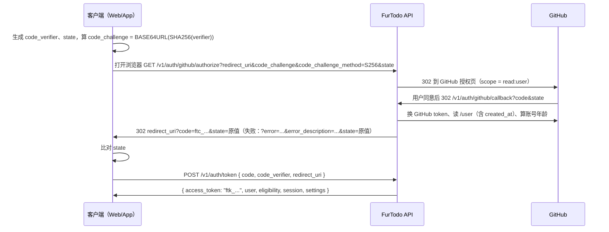

# FurTodo API 对接指南

> 给要做 **Web（CSR，不要 SSR）** 与 **App** 的工程师／AI agent。照这份文档就能做出完整、可离线使用的待办 App。
> 机器可读规格：`/openapi.json`（OpenAPI 3.1）。交互文档：`/docs`。本文档在线版：`/integration.md`。

## 0. 速查

| 项目 | 值 |
|---|---|
| Base URL（示例，换成你自己的部署地址） | `https://todo.example.com` |
| OpenAPI | `https://todo.example.com/openapi.json` |
| 交互文档（可直接在线调试 API） | `https://todo.example.com/docs` |
| 开发者登录／获取 token | `https://todo.example.com/dev/login` |
| 登录方式 | GitHub OAuth；要求 **GitHub 账号创建满一年**（`MIN_ACCOUNT_AGE_DAYS` = 365，不看组织） |
| 认证 | `Authorization: Bearer ftk_...`（不使用 cookie） |
| CORS | 任何 origin；允许 `Authorization`、`Content-Type` header |
| 日期 | `YYYY-MM-DD`（日历日，不含时区） |
| 时间 | `HH:mm`（24 小时制，依用户设置的时区解读） |
| 时刻 | ISO 8601；服务器响应一律是 UTC，例如 `2026-11-20T07:00:00.000Z` |
| ID | 客户端生成，建议 **UUIDv7**；只允许 `A-Z a-z 0-9 _ -`，长度 1–64 |
| 错误格式 | `{ "error": { "code": "...", "message": "...", "details": { ... } } }` |
| 调试 | 每个响应都有 `X-Request-Id`，报告问题时附上 |

**一句话架构**：后端是 Cloudflare Workers，所有数据（实体、session、每日配额、提醒、Web Push 订阅）存在 PostgreSQL，经 Hyperdrive 连接池访问，用 Drizzle ORM 读写，schema 变更用 drizzle-kit migration。同一用户的写入在数据库事务里串行执行；到期提醒由每分钟一次的定时任务发送。客户端应该做成 **离线优先（offline-first）**：本地数据库是 UI 的真实来源，背景用 `/v1/sync/push` 与 `/v1/sync/pull` 同步。

---

## 1. 功能对照表（做 App 时的验收清单）

| 需求 | 对应字段／API | UI 必须做到 |
|---|---|---|
| 明确的行动动词 | `task.title` | 输入框 placeholder 提示“用动词开头，例如：打电话给王先生确认报价” |
| 截止日期 | `dueDate`、`dueTime`（`dueAt` 只读） | 日期＋选填时间；逾期红字 |
| 提醒 | `reminders[].at` | 可加多个提醒；Web 用 Web Push、App 用本地通知（§8） |
| 预估时间／精力 | `estimateMinutes`、`energy` | 15m/30m/1h 快捷；低/中/高精力；“碎片时间”筛选（`maxEstimate`） |
| 优先顺序 | `priority`（0–3） | 星号或颜色 |
| 四象限 | `quadrant`（1–4，null 未分类） | 四象限视图 `/v1/views/matrix` |
| 清单／文件夹 | `list`、`folder`、`task.listId` | 侧栏：文件夹 → 清单；没有清单 = 收件箱 |
| 情境标签 | `tag`、`task.tagIds` | `#外出办事`、`#电脑前`、`#低耗脑力`；依标签筛选 |
| 子任务 | `subtasks[]` | 勾选清单、拖拽排序、进度（3/5） |
| 备注与链接 | `notes`（Markdown）、`links[]` | 备注编辑器、链接（网址/mailto/tel） |
| 周期性重复 | `recurrence` | 每天/每周几/每月几号/每年/完成后 N 天；完成时服务器自动生成下一期 |
| 快速收集 | `POST /v1/capture` | 全局快捷键／悬浮按钮，一行文字 1–2 秒内存好（§7） |
| 今日视图 | `myDay`、`/v1/views/today` | “我的一天”：挑今天要做的事；显示最关键 1–3 件（focus） |
| 多平台同步＋离线 | `/v1/sync/*` | 无网络可添加/编辑/完成；恢复连接自动同步（§5） |

---

## 2. 登录：GitHub OAuth + PKCE

### 2.1 流程



- 准入门槛只有一个：**GitHub 账号创建满一年**。服务器用 `GET /user` 的 `created_at` 算年龄（`MIN_ACCOUNT_AGE_DAYS`，默认 365 天），不读取任何组织信息，也不需要 `read:org` 权限。
- 登录后服务器每 6 小时用同一 token 重新读一次 `/user`；token 被撤销就注销所有 session（API 返回 `401 invalid_token`）。账号只会变老，所以门槛不会再次阻挡已登录用户。

### 2.2 redirect_uri 白名单

| 样式 | 用途 |
|---|---|
| `http://localhost:*/*`、`http://127.0.0.1:*/*` | 本机开发（任何 port、任何 path） |
| `https://*.example.com/*` | 正式部署的 Web（示例，见 `ALLOWED_REDIRECT_URIS`） |
| `furtodo://*` | App（custom URL scheme，建议 `furtodo://auth/callback`） |
| `https://todo.example.com/dev/login` | 内置开发者登录页 |

要加新域名请改后端的 `ALLOWED_REDIRECT_URIS`。不在白名单 → `400 bad_request`（不会跳转）。

### 2.3 Web（CSR）示例

```ts
const API = "https://todo.example.com";
const REDIRECT_URI = `${location.origin}/auth/callback`;

const b64url = (buf: ArrayBuffer | Uint8Array) =>
  btoa(String.fromCharCode(...new Uint8Array(buf))).replace(/\+/g, "-").replace(/\//g, "_").replace(/=+$/, "");

export async function startLogin() {
  const verifier = b64url(crypto.getRandomValues(new Uint8Array(32)));
  const state = b64url(crypto.getRandomValues(new Uint8Array(16)));
  sessionStorage.setItem("pkce", JSON.stringify({ verifier, state }));
  const challenge = b64url(await crypto.subtle.digest("SHA-256", new TextEncoder().encode(verifier)));
  const q = new URLSearchParams({ redirect_uri: REDIRECT_URI, code_challenge: challenge, code_challenge_method: "S256", state });
  location.assign(`${API}/v1/auth/github/authorize?${q}`);
}

// 在 /auth/callback 路由执行
export async function finishLogin(): Promise<string> {
  const q = new URLSearchParams(location.search);
  const saved = JSON.parse(sessionStorage.getItem("pkce") ?? "null");
  sessionStorage.removeItem("pkce");
  if (q.get("error")) throw new Error(`${q.get("error")}: ${q.get("error_description")}`);
  if (!saved || saved.state !== q.get("state")) throw new Error("state mismatch");
  const res = await fetch(`${API}/v1/auth/token`, {
    method: "POST",
    headers: { "Content-Type": "application/json" },
    body: JSON.stringify({ grant_type: "authorization_code", code: q.get("code"), code_verifier: saved.verifier, redirect_uri: REDIRECT_URI }),
  });
  const body = await res.json();
  if (!res.ok) throw new Error(body.error.message);
  localStorage.setItem("token", body.access_token); // 或存 IndexedDB
  history.replaceState(null, "", "/");
  return body.access_token;
}
```

`/dev/login` 页面的源代码就是完整的参考实现（浏览器“查看源代码”）。

### 2.4 App 示例要点

1. `redirect_uri = furtodo://auth/callback`，在 App 注册 custom URL scheme `furtodo`。
2. 用 **系统浏览器组件** 打开 authorize 网址：iOS `ASWebAuthenticationSession`、Android Custom Tabs。
   Flutter：`flutter_web_auth_2`（callbackUrlScheme: `furtodo`）；Expo：`expo-web-browser` 的 `openAuthSessionAsync`。
3. 收到 `furtodo://auth/callback?code=...&state=...` 后，与 Web 相同，调用 `POST /v1/auth/token`。
4. token 存放在安全存储（Keychain / Keystore；Flutter `flutter_secure_storage`、Expo `expo-secure-store`）。

### 2.5 登录失败的 `error` 值（重定向回 redirect_uri 的 query）

| error | 意义／处理 |
|---|---|
| `access_denied` | 用户在 GitHub 取消 |
| `account_too_new` | GitHub 账号创建未满一年（`error_description` 会带当前天数与创建日期） |
| `github_error` / `invalid_request` | GitHub 暂时有问题，重试 |
| `quota_exceeded` | 今日登录次数超过上限 |

`POST /v1/auth/token` 失败返回 `400`，`details.oauthError = "invalid_grant"`（登录码过期 5 分钟／已用过／verifier 或 redirect_uri 不匹配）→ 重新登录。

### 2.6 Token 与 session

- access token 有效 30 天，**有使用就自动延长**（滑动过期）。没有 refresh token。
- 任何 API 返回 `401`（`invalid_token`、`session_expired`）→ 清掉 token、跳转到登录。
- `GET /v1/me`：用户、组织角色、**用户所属的 GitHub 组织清单**、设置。
- `GET /v1/auth/sessions`：所有登录中的设备；`DELETE /v1/auth/sessions/{id}`：退出某个设备；`POST /v1/auth/logout`：退出当前设备。
- `POST /v1/auth/tokens` `{ "name": "...", "expiresInDays": 90 }`：创建**个人 token**（给 CLI／脚本／AI agent 测试 API；只返回一次）。也可以在 `/dev/login` 点按钮创建。

---

## 3. 数据模型

### 3.1 所有实体公共字段（只读）

| 字段 | 类型 | 说明 |
|---|---|---|
| `id` | string | 客户端生成（建议 UUIDv7） |
| `rev` | int | 每次变更 +1 |
| `createdAt` | ISO | |
| `updatedAt` | ISO | 服务器时间，同一用户内严格递增 |
| `deletedAt` | ISO \| null | 非 null = 在回收站（30 天后永久删除） |

### 3.2 Task

| 字段 | 类型 | 默认 | 说明 |
|---|---|---|---|
| `title` | string 1–500 | 必填 | 具体可执行的行动 |
| `notes` | string ≤ 20000 | `""` | Markdown，可放联系方式、参考资料 |
| `listId` | id \| null | null | null = 收件箱 |
| `tagIds` | id[] ≤ 20 | `[]` | 情境标签 |
| `priority` | 0–3 | 0 | 0 无、1 低、2 中、3 高 |
| `quadrant` | 1–4 \| null | null | 1 重要且紧急、2 重要不紧急、3 紧急不重要、4 都不 |
| `dueDate` | date \| null | null | |
| `dueTime` | time \| null | null | 需要 dueDate；没有 dueDate 时服务器会清成 null |
| `dueAt` | ISO \| null | 只读 | dueDate+dueTime 依用户时区换算；全天任务为 null |
| `reminders` | `{id, at}[]` ≤ 10 | `[]` | `at` 绝对时刻；id 省略时服务器补 |
| `estimateMinutes` | 1–1440 \| null | null | |
| `energy` | `low`\|`medium`\|`high`\|null | null | |
| `subtasks` | `{id, title, completed}[]` ≤ 100 | `[]` | **整个数组一起覆盖**；数组顺序即显示顺序 |
| `links` | `{id, url, title}[]` ≤ 50 | `[]` | url 限 `http(s)://`、`mailto:`、`tel:` |
| `recurrence` | Recurrence \| null | null | §3.5 |
| `seriesId` | id \| null | 只读 | 重复系列共用 |
| `myDay` | date \| null | null | 加入“我的一天”的日期 |
| `myDayOrder` | number \| null | null | My Day 内排序 |
| `sortOrder` | number | 创建时间 ms | 清单内排序 |
| `completedAt` | ISO \| null | null | null = 未完成 |

### 3.3 List / Folder / Tag / Settings

| 实体 | 字段 |
|---|---|
| `list` | `name`（必填 ≤100）、`color`（`#RRGGBB`\|null）、`icon`（≤32，emoji 或图标名）、`folderId`（\|null）、`sortOrder`、`archived`（bool） |
| `folder` | `name`（必填 ≤100）、`sortOrder` |
| `tag` | `name`（必填 ≤32，不可含空白、`#`、`@`）、`color`。名称不保证唯一 |
| `settings`（id 固定 `"main"`） | `timezone`（IANA，默认 `Asia/Shanghai`）、`weekStart`（0 周日／1 周一，默认 1）、`defaultReminderTime`（默认 `09:00`）、`todayIncludesOverdue`（默认 true）、`locale`（默认 `zh-CN`） |

### 3.4 排序

`sortOrder`、`myDayOrder` 是浮点数，小的在前。插入到 A、B 之间用 `(A + B) / 2`；放最前面用 `第一个 - 1024`、最后面用 `最后一个 + 1024`。间距小于 `1e-6` 时才整批重新编号（会产生多条写入，尽量避免）。

### 3.5 重复任务（Recurrence）

```jsonc
{
  "freq": "weekly",          // daily | weekly | monthly | yearly
  "interval": 1,             // 每 N 个 freq（1–365）
  "byWeekday": [1, 3, 5],    // weekly：0=周日…6=周六；省略 = 到期日那天的星期
  "byMonthDay": 15,          // monthly/yearly：1–31，-1 = 月底；月份没那天就用月底
  "byMonth": 3,              // yearly：1–12
  "until": "2027-12-31",     // 选填，含当天
  "count": 10,               // 选填，剩余次数（含本期）
  "basis": "due"             // due：按计划；completion：完成日 + interval
}
```

- 设置 `recurrence` 时服务器会**规范化**：把省略的 `byWeekday`／`byMonthDay`／`byMonth` 按到期日补上并存起来（避免 1/31 → 2/28 → 3/28 的漂移）。没有 `dueDate` 时，服务器把 `dueDate` 设成今天（含）以后第一个符合的日期。
- **完成重复任务时服务器会生成下一期**（新任务，`seriesId` 相同），返回在 `spawned`（REST `/complete` 或 sync push 结果），之后也会出现在 pull。
  - **客户端不要自己创建下一期**。下一期的 id 由“系列＋日期”决定，多台设备同时完成也不会重复。
  - 复制：title、notes、listId、tagIds、priority、quadrant、dueTime、estimateMinutes、energy、links、子任务（全部改回未完成）、提醒（向后平移同样的天数）。不复制：myDay、completedAt。
  - `basis: "due"` 逾期才完成：下一期会追到“今天（含）以后”，不会补一堆过去的。
  - `count` 用完或超过 `until` 就不再生成。

### 3.6 删除与回收站

- 删除＝移到回收站（`deletedAt` 有值），30 天内可 `POST /v1/{tasks|lists|folders|tags}/{id}/restore` 恢复。`GET /v1/trash` 列出回收站。
- **删除清单**：清单内的任务在同一次写入里一起移到回收站（响应只返回清单本身，任务从 pull 收到）；恢复清单会把这些随清单删除的任务一起恢复。客户端删除清单时，本地也直接把这些任务标记为删除即可。
- **删除标签／文件夹**：任务的 `tagIds`、清单的 `folderId` **不会被清掉**（这样恢复时能完整还原）。客户端显示时忽略指向已删除或不存在实体的 id。
- 恢复任务时，如果它的清单已删除，会被移到收件箱。
- 已删除的实体不能修改（`409 deleted`），要先恢复。

---

## 4. API 一览

所有 `/v1/*`（除了标注“公开”）都要 `Authorization: Bearer`。完整请求／响应 schema 看 `/openapi.json`。

| 方法 | 路径 | 说明 |
|---|---|---|
| GET | `/v1/auth/github/authorize` | 公开。开始登录（§2） |
| POST | `/v1/auth/token` | 公开。登录码换 token |
| POST | `/v1/auth/logout` | 退出当前 session |
| GET / DELETE | `/v1/auth/sessions`、`/v1/auth/sessions/{id}` | 设备管理 |
| POST | `/v1/auth/tokens` | 创建个人 token |
| GET | `/v1/me` | 用户、组织、组织清单、设置 |
| GET | `/v1/usage` | 今日配额用量与上限 |
| GET / PATCH | `/v1/settings` | 设置 |
| GET | `/v1/tasks` | 查询：`status=open\|completed\|all`、`listId`、`inbox=true`、`tagId`、`q`、`dueFrom`、`dueTo`、`priority`、`quadrant`、`energy`、`maxEstimate`、`myDay`、`includeDeleted`、`limit`（≤2000） |
| POST | `/v1/tasks` | 创建（可带 `id`；同 id 重送是幂等的） |
| GET / PATCH / DELETE | `/v1/tasks/{id}` | 读／部分更新／删除 |
| POST | `/v1/tasks/{id}/complete`、`/uncomplete`、`/restore` | 完成（返回 `{task, spawned}`）、取消完成、恢复 |
| GET / POST | `/v1/lists`、`/v1/folders`、`/v1/tags` | 列出全部（未删除）／创建 |
| GET / PATCH / DELETE | `/v1/{lists\|folders\|tags}/{id}` | |
| POST | `/v1/{lists\|folders\|tags}/{id}/restore` | |
| GET | `/v1/trash` | 回收站 `{ items: [{ type, entity }] }` |
| GET | `/v1/views/today?date=` | 今日视图（§6） |
| GET | `/v1/views/upcoming?from=&days=` | 即将到来，按日期分组（days ≤ 62） |
| GET | `/v1/views/matrix` | 四象限 |
| POST | `/v1/capture` | 快速收集（§7） |
| POST | `/v1/sync/push` | 批量提交变更（§5） |
| GET | `/v1/sync/pull?cursor=&limit=` | 拉增量（§5） |
| GET | `/v1/push/vapid-public-key` | 公开。Web Push 公钥 |
| POST / DELETE | `/v1/push/subscriptions` | 登记／取消推送订阅（DELETE 用 `?endpoint=`） |
| POST | `/v1/push/test` | 发送测试推送 |

PATCH 只发送要改的字段；未知字段或只读字段会 `400 validation_error`。PATCH 不存在的 id → `404`（创建请用 POST）。

---

## 5. 离线同步（最重要）

### 5.1 原则

- 本地数据库（Web：IndexedDB／Dexie；App：SQLite）存所有实体，**UI 只读本地**。
- 用户的每个操作：立刻改本地 → 加一条 mutation 到 **outbox**（本地队列）→ 调度同步。
- 同步 = 先 `push` outbox，再 `pull` 到没有更多为止。
- 触发时机：App 启动、回到前台、网络恢复、本地编辑后（debounce 1–2 秒）、前台时每 30–60 秒轮询。
- **没有变更时 pull 只消耗 1 次请求配额**，放心轮询；但不要比每 15 秒更频繁。

### 5.2 Push

```http
POST /v1/sync/push
{
  "mutations": [
    { "op": "upsert", "type": "task", "id": "019a…", "data": { "title": "买牛奶", "listId": null }, "at": 1763539200000 },
    { "op": "upsert", "type": "task", "id": "019b…", "data": { "completedAt": "2026-11-19T02:00:00.000Z" }, "at": 1763539300000 },
    { "op": "delete", "type": "tag",  "id": "019c…", "at": 1763539400000 },
    { "op": "restore", "type": "task", "id": "019d…" }
  ]
}
```

- `op`：`upsert`（不存在就创建、存在就部分更新）、`delete`、`restore`。
- `type`：`task`、`list`、`folder`、`tag`、`settings`（settings 的 id 固定 `"main"`）。
- `data`：该类型的 Patch（同 REST PATCH）。**只放有改动的字段**。创建时要有必填字段（task.title、list/folder/tag.name），否则 `rejected not_found`。
- `at`：用户**实际编辑的时间**（epoch ms）。服务器做 **逐字段 Last-Writer-Wins**：某字段只有在 `at` ≥ 服务器上该字段最后被写入的 `at` 时才会被覆盖，所以离线很久的设备不会覆盖掉其他设备较新的修改。`at` 比服务器时间晚会被当成服务器当前时间。
- 一次最多 200 条；每条独立处理，响应顺序与请求相同：

```jsonc
{ "results": [
  { "index": 0, "type": "task", "id": "019a…", "op": "upsert", "status": "applied", "entity": { /* 服务器最新状态 */ }, "spawned": [], "error": null },
  { "index": 1, "status": "applied", "entity": { … }, "spawned": [ { /* 重复任务的下一期 */ } ], … },
  { "index": 2, "status": "noop", … },
  { "index": 3, "status": "rejected", "entity": null, "error": { "code": "not_found", "message": "…", "status": 404 } }
] }
```

| status／error.code | 客户端处理 |
|---|---|
| `applied`、`noop` | 用 `entity` 覆盖本地（除非本地还有更新的未发送变更，见 5.4）；`spawned` 写入本地 |
| `rejected` + `validation_error` | 丢弃这条 mutation（程序错误，记 log） |
| `rejected` + `deleted` | 实体已在回收站：丢弃这条，本地用 `entity` 覆盖（会显示为已删除） |
| `rejected` + `not_found` | 丢弃（例如对不存在的实体做 restore／缺必填字段） |
| `rejected` + `quota_exceeded` | **保留** outbox，`error.retryAfter` 秒后再发送 |
| `rejected` + `limit_exceeded` | 丢弃并提示用户（数据条数上限） |

所有 mutation 都是**幂等**的：网络中断不知道有没有成功时，整批重发即可。

### 5.3 Pull

```http
GET /v1/sync/pull                 # 第一次：全量快照（不含回收站）
GET /v1/sync/pull?cursor=eyJ2Ijoy…   # 之后：增量（含删除）
```

```jsonc
{
  "changes": [ { "type": "task", "entity": { … } }, { "type": "settings", "entity": { … } } ],
  "cursor": "eyJ2IjoyLCJzIjoxNzYzNTM5…",   // 存起来下次带回（不透明字符串）
  "hasMore": false,                         // true → 立即用新 cursor 再拉
  "reset": false,                           // true → cursor 之后有删除记录已被永久清除（回收站超过 30 天），清掉本地数据（保留 outbox），不带 cursor 重新拉取
  "serverTime": "2026-11-19T10:00:00.000Z"
}
```

- `changes` 按服务器写入顺序由旧到新（同一次写入的多个实体 `updatedAt` 相同），每个实体只会出现最新版本。
- `entity.deletedAt` 非 null → 本地标记删除（或移到回收站界面）。
- `limit` 默认 500，最大 1000。
- 应用规则：只有在 `entity.rev` ≥ 本地 rev 时才覆盖（避免回退），且不要覆盖本地还在 outbox 里没发送的字段（见 5.4）。

### 5.4 建议的客户端算法

```ts
// 本地表：entities(type, id, json, rev)、outbox(seq, mutation)、meta(cursor)
async function sync() {
  // 1) push
  while (true) {
    const batch = await outbox.peek(200);
    if (batch.length === 0) break;
    const res = await api.post("/v1/sync/push", { mutations: batch.map((b) => b.mutation) });
    if (res.status === 401) return logout();
    if (!res.ok) throw new RetryLater(res); // 网络/5xx：保留 outbox，指数退避
    for (const r of res.body.results) {
      const item = batch[r.index];
      if (r.status === "rejected" && r.error.code === "quota_exceeded") {
        return scheduleRetry(r.error.retryAfter); // 保留这条与之后的
      }
      await outbox.remove(item.seq);
      if (r.entity) await applyServerEntity(r.type, r.entity);
      for (const s of r.spawned) await applyServerEntity("task", s);
    }
  }
  // 2) pull
  let cursor = await meta.get("cursor");
  while (true) {
    const res = await api.get("/v1/sync/pull", cursor ? { cursor } : {});
    if (res.body.reset) { await entities.clear(); cursor = null; await meta.set("cursor", null); continue; }
    for (const c of res.body.changes) await applyServerEntity(c.type, c.entity);
    cursor = res.body.cursor;
    await meta.set("cursor", cursor);
    if (!res.body.hasMore) break;
  }
}

async function applyServerEntity(type, entity) {
  const local = await entities.get(type, entity.id);
  if (local && local.rev > entity.rev) return;          // 本地已有更新的服务器版本
  const merged = { ...entity };
  for (const m of await outbox.pendingFor(type, entity.id)) {   // 重新套上还没发送的本地修改
    if (m.op === "upsert") Object.assign(merged, m.data);
  }
  await entities.put(type, merged);
}
```

本地编辑时：

```ts
function editTask(id: string, changes: Partial<Task>) {
  entities.patch("task", id, changes);                               // 1. 乐观更新 UI
  outbox.add({ op: "upsert", type: "task", id, data: changes, at: Date.now() }); // 2. 记录变更
  debounceSync(1500);                                                // 3. 稍后同步
}
```

- 新建实体：客户端先生成 UUIDv7 作为 id，再 `upsert`（含必填字段）。
- 文字输入不要每个字都发送一次：**编辑结束或停顿 1–2 秒才写入 outbox**，以节省请求与写入配额。
- 同一实体连续多条未发送的 upsert 可以合并（`data` 合并、`at` 取最大值）。
- 完成重复任务：只发送 `completedAt`，下一期等服务器返回。离线时 UI 可以先显示“已完成”。

### 5.5 一致性说明

- 同一用户的写入在数据库事务里串行执行，服务器上不会丢失更新；跨设备冲突以“字段 + 编辑时间”决定。
- 同步（push 响应、pull）一定看得到自己刚写入的数据。
- `subtasks`、`links`、`reminders`、`tagIds` 是“整个数组”一个字段：两台设备同时修改同一个任务的子任务，较晚编辑的整个数组胜出。

---

## 6. 视图

视图 API 方便在线模式使用；离线优先的客户端也可以用本地数据按下面规则自己计算（结果一致）。日期以用户 `settings.timezone` 的“今天”为准。

### `GET /v1/views/today?date=YYYY-MM-DD`

| 区块 | 规则 |
|---|---|
| `myDay` | 未完成且 `myDay == date`，按 `myDayOrder`、`sortOrder` |
| `overdue` | 未完成、`dueDate < date`、不在 My Day（`todayIncludesOverdue=false` 时为空） |
| `dueToday` | 未完成、`dueDate == date`、不在 My Day |
| `suggestions` | 不在上面三个区块的未完成任务中：昨天以前 My Day 没做完的、3 天内到期、`priority=3`、`quadrant` 1 或 2；按分数排序，最多 20 条 |
| `completed` | `completedAt` 落在当天（用户时区） |
| `focus` | `myDay ∪ overdue ∪ dueToday` 按分数取前 3：今天最关键的事 |
| `stats` | `open`（三个区块总数）、`completed`、`plannedMinutes`（三者 estimateMinutes 总和） |

分数 = 四象限（Q1 400、Q2 200、Q3 100）＋ `priority × 50` ＋ 到期加分（逾期：60 ＋ 逾期天数 × 10，后者最多 100；今天到期 60；明天 20；后天 10）＋ 已在今天 My Day 40 ＋ 预估 ≤ 15 分钟 5。同分按 `dueTime`、`sortOrder`。

“加入我的一天”= PATCH `myDay` 为今天；“移出”= `myDay: null`。My Day 每天自动清空（因为只认 `myDay == 今天`），昨天没做完的会出现在 `suggestions`。

### `GET /v1/views/upcoming?from=&days=7`

`dates: [{ date, tasks }]` 从 `from`（默认今天）连续 `days` 天（含空的日子），任务按 `dueDate`、`dueTime`；`overdue` 为今天以前到期未完成（`from` 在今天以后时为空）。

### `GET /v1/views/matrix`

`q1`–`q4` 为各象限未完成任务（按分数），`unclassified` 为 `quadrant=null` 的未完成任务（最多 100）。

---

## 7. 快速收集 `POST /v1/capture`

```jsonc
// 请求
{ "text": "明天下午3点 打电话给王先生确认报价 #电脑前 @工作 !高 ~15m", "myDay": false, "dryRun": false }
// 响应 201（dryRun=true 时 200 且 task=null）
{
  "task": { … },
  "createdTags": [ { "id": "…", "name": "电脑前" } ],
  "parsed": { "title": "打电话给王先生确认报价", "dueDate": "2026-11-20", "dueTime": "15:00", "priority": 3, "estimateMinutes": 15,
              "tags": ["电脑前"], "list": "工作", "tokens": [ { "kind": "date", "text": "明天", "start": 0, "end": 2 }, … ], "warnings": [] },
  "resolved": { "listId": "…", "tagIds": ["…"], "newTags": [] },
  "warnings": []
}
```

- 输入时用 `dryRun: true`（debounce 300ms）实时预览，`tokens` 的位移可以拿来在输入框标色。
- `listId` 指定清单（优先于 `@清单`）；`myDay: true` 同时加入今天的 My Day；`parse: false` 整段作为标题。
- **离线时**：直接在本地创建 `title = 原文` 的任务放进 outbox，不要卡住用户。

| 语法 | 示例 | 结果 |
|---|---|---|
| `#标签` | `#外出办事` | 标签（不存在自动创建；前面要有空白或在开头） |
| `@清单` | `@工作` | 比对清单名称（完全相同优先，其次前缀）；找不到 → warning，放进收件箱 |
| `!1` `!2` `!3`／`!低` `!中` `!高`／`!low` `!med` `!high`／`!!` `!!!` | `!高` | priority |
| `!q1`–`!q4` | `!q2` | quadrant |
| `~` 时长 | `~15m` `~1h` `~1.5h` `~1h30m` `~半小时` `~90` | estimateMinutes |
| `%` 精力 | `%低` `%中` `%高` `%low` | energy |
| `*` 重复 | `*每天` `*每3天` `*工作日` `*每周一三五` `*每2周一` `*每月15号` `*每月最后一天` `*每年` `*完成后3天` `*daily` `*weekdays` `*every-mon,wed` `*every-2-weeks` `*after-3-days` | recurrence |
| 日期 | `今天` `明天` `后天` `大后天` `周五` `下周一` `3天后` `11月30日` `3号` `月底` `2026-12-25` `12/25` `today` `tomorrow` `fri` `next mon` `in 3 days` `eom` | dueDate |
| 时间 | `下午3点` `下午三点半` `晚上8点15分` `15:00` `3pm` `3:30pm` `at 3pm` `noon` `今晚`（20:00） | dueTime（只有时间：今天若已过就排明天） |

标记类（`# @ ! ~ % *`）都要以空白分隔；中文日期／时间可以黏在文本里（`明天下午3点打电话`）。全角 `＃＠！～％＊` 也可以。

---

## 8. 提醒

数据层只有 `task.reminders: [{ id, at }]`（绝对时刻）。只有日期的任务，UI 建议默认 `dueDate` + `settings.defaultReminderTime`。任务完成或删除后提醒自动失效。服务器每分钟检查一次到期提醒，Web Push 最多晚约 1 分钟送达。

### 8.1 Web：Web Push（页面关掉也收得到）

```ts
// main thread
const reg = await navigator.serviceWorker.register("/sw.js");
const { publicKey } = await (await fetch(`${API}/v1/push/vapid-public-key`)).json();
const sub = await reg.pushManager.subscribe({ userVisibleOnly: true, applicationServerKey: base64UrlToUint8Array(publicKey) });
await fetch(`${API}/v1/push/subscriptions`, {
  method: "POST",
  headers: { Authorization: `Bearer ${token}`, "Content-Type": "application/json" },
  body: JSON.stringify({ ...sub.toJSON(), device: navigator.userAgent.slice(0, 60) }),
});

// sw.js
self.addEventListener("push", (event) => {
  const data = event.data?.json() ?? {};
  // reminder: { type: "reminder", taskId, reminderId, title, dueDate, dueTime, at }
  // test:     { type: "test", title, body, at }
  event.waitUntil(self.registration.showNotification(data.title ?? "FurTodo", {
    body: data.type === "reminder" ? [data.dueDate, data.dueTime].filter(Boolean).join(" ") : data.body,
    tag: data.taskId, data,
  }));
});
self.addEventListener("notificationclick", (event) => {
  event.notification.close();
  event.waitUntil(clients.openWindow(`/tasks/${event.notification.data?.taskId ?? ""}`));
});
```

- 取消：`DELETE /v1/push/subscriptions?endpoint=<encodeURIComponent(endpoint)>`；退出登录时记得取消。
- 测试：`POST /v1/push/test`。
- 推送服务返回 404/410 的订阅，服务器会自动删除。每位用户最多 10 个订阅。
- iOS Safari 需要把网站“添加到主屏幕”（PWA）才能接收 Web Push。

### 8.2 App：本地通知

- 每次同步完成后，对“未完成、未删除”任务的 `reminders` 安排本地通知（Flutter `flutter_local_notifications`、Expo `expo-notifications`）；通知 id 用 `taskId + reminderId` 的哈希。
- 任务完成／删除／提醒被移除 → 取消对应通知。
- iOS 最多 64 个待排通知：只排最近的 64 个，下次同步再补。
- App 不需要登记 Web Push。

---

## 9. 配额与上限

每位用户**每日**配额（`QUOTA_TIMEZONE` = `Asia/Shanghai`，即上海时间 00:00 重置），超过时返回 `429 quota_exceeded`，`Retry-After` header 为距离重置的秒数：

| 项目 | 默认上限 | 消耗方式 |
|---|---|---|
| requests | 20,000 | 每个需要登录的 API 调用 |
| reads | 200,000 | 从数据库读出的数据条数（每条 1） |
| writes | 10,000 | 实际写入的数据条数（值没变不算）；删除／恢复清单时连带的任务也计入，但不会因此被拒绝 |
| logins | 30 | 登录次数 |
| pushes | 500 | 推送发送数 |

总量上限：未删除的实体 20,000 条（任务＋清单＋文件夹＋标签，超过 `403 limit_exceeded`）。

配额按**每位用户**计算，不是全站共享；单日内反复触发上限只会让该用户当天被限流，不会影响其他人。`GET /v1/usage` 可以查询今天用了多少。节省配额的做法：

- 用 sync（push/pull）而不是频繁调用视图或 `GET /v1/tasks`：增量 pull 只读取有变更的数据。
- 编辑 debounce、合并 mutation。
- 视图与 `GET /v1/tasks` 会读取所有符合条件的任务、全量 pull 会读取全部数据，留给“没有本地数据库”的场景。

登录相关端点另有每 IP 每分钟 30 次的限流（`429 rate_limited`）。

---

## 10. 错误

```json
{ "error": { "code": "validation_error", "message": "请求格式错误", "details": { "issues": [ { "path": "title", "message": "Too small: expected string to have >=1 characters", "code": "too_small" } ] } } }
```

| HTTP | code | 处理 |
|---|---|---|
| 400 | `validation_error`、`bad_request` | 修正请求；`details.issues` 指出字段 |
| 401 | `invalid_token`、`session_expired` | 重新登录 |
| 403 | `account_too_new` | GitHub 账号未满一年；`details` 会带天数与最小要求 |
| 403 | `limit_exceeded` | 数据条数已满 |
| 404 | `not_found` | |
| 409 | `deleted` | 实体在回收站，先恢复 |
| 409 | `limit_exceeded` | 推送订阅数已满 |
| 429 | `quota_exceeded`、`rate_limited` | 等 `Retry-After` 秒 |
| 503 | `github_unavailable`、`storage_busy`、`storage_unavailable` | 稍后重试 |
| 500 | `internal_error` | 附上 `details.requestId` 上报 |

---

## 11. 给 AI agent 的实现建议

### Web（CSR / SPA，不要 SSR）

- Vite + React（或 Vue/Svelte）+ TypeScript，纯静态部署（Cloudflare Pages／Workers Static Assets 皆可）。
- 类型与 client：`npx openapi-typescript https://todo.example.com/openapi.json -o src/api/schema.d.ts`，搭配 `openapi-fetch`。
- 本地数据：IndexedDB（Dexie）存 entities、outbox、cursor；按照 §5.4 实现同步。
- PWA：Service Worker 缓存 app shell（离线可开）、处理 Web Push（§8.1）、manifest（可添加到主屏幕）。
- 路由：`/`（今日）、`/inbox`、`/lists/:id`、`/tags/:id`、`/upcoming`、`/matrix`、`/trash`、`/settings`、`/auth/callback`。
- 快速收集：全局快捷键（例如 `Q` 或 `Ctrl/⌘+K`）打开输入框，Enter 提交，`dryRun` 实时预览。

### App

- Flutter（drift／sqflite、flutter_web_auth_2、flutter_secure_storage、flutter_local_notifications）或 Expo（expo-sqlite、expo-web-browser、expo-secure-store、expo-notifications）。
- custom scheme `furtodo`，redirect `furtodo://auth/callback`。
- 同样的离线同步算法（§5.4）；App 回到前台时同步；后台同步可选。
- 快速收集：首页悬浮按钮、App 快捷方式（Android App Shortcuts／iOS Quick Actions）、分享菜单收集文字。

### 验收

1. 用创建满一年的 GitHub 账号能登录；新账号看到 `account_too_new` 与具体天数。
2. 飞行模式下添加／编辑／完成／删除都正常，恢复网络后另一台设备 1 分钟内看到。
3. 两台设备离线修改同一任务的不同字段，同步后两边的修改都在。
4. 完成“每周一三五”的任务会出现下一期，且只出现一次。
5. 今日视图显示 focus、My Day、逾期、今天到期、建议。
6. 提醒时间到：Web（页面关闭）收到推送、App 收到本地通知。
7. 一行输入 `明天下午3点 打电话给王先生确认报价 #电脑前 @工作 !高 ~15m` 创建出正确任务。
8. 收到 `429` 时有提示且不会无限重试。

---

## 12. 用 curl 测试

先到 `/dev/login` 登录，复制 token（或创建个人 token）：

```bash
API=https://todo.example.com
TOKEN=ftk_...
curl -s -H "Authorization: Bearer $TOKEN" $API/v1/me
curl -s -H "Authorization: Bearer $TOKEN" -H 'Content-Type: application/json' \
  -d '{"text":"明天下午3点 打电话给王先生确认报价 #电脑前 !高 ~15m"}' $API/v1/capture
curl -s -H "Authorization: Bearer $TOKEN" $API/v1/views/today
curl -s -H "Authorization: Bearer $TOKEN" $API/v1/sync/pull
curl -s -H "Authorization: Bearer $TOKEN" $API/v1/usage
```
